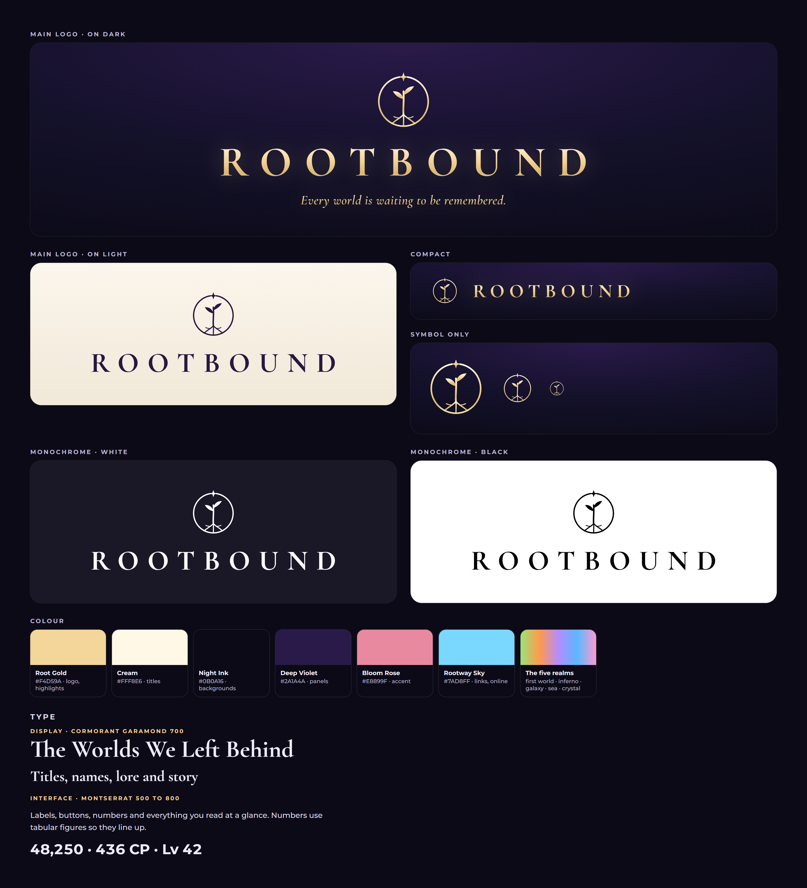

# The Rootbound brand

## The logo system

The files live in `assets/brand/`. The PNGs are photographed from `tools/brand/brand.html` by `node tools/brand/export.js`, which also writes `docs/brand-sheet.png`.

| Version | File | Use |
|---|---|---|
| Symbol | `symbol.svg` (gold), `symbol-mono.svg` (white), `symbol-plum.svg`, `symbol-black.svg` | the app icon, the page icon, small spaces, the phone |
| Main logo on dark | `logo-dark.png` | the title, the trailer, announcements |
| Main logo on light | `logo-light.png` | light pages and print |
| Compact | `logo-compact.png` | headers and the launcher bar |
| Monochrome | `logo-mono-white.png`, `logo-mono-black.png` | one-colour use |
| Social card | `social.png` (1200×630) | links, posts, store pages |

**The symbol** is a sapling whose roots curl round into a ring, the world it holds together, under a small star. It is original artwork and draws in five strokes, so it stays clear down to 32 px.

**The wordmark** is ROOTBOUND in Cormorant Garamond 700, set wide (0.3em), in the gold gradient on dark or in Plum `#2A1640` on light.

**Clear space:** keep at least the height of the symbol's star around the logo. Never stretch it, recolour it outside the palette, or set the wordmark in another font.

**Animated reveal:** at launch, after the intro film, the logo plays for about 4 seconds over the starting game (`src/js/late/99-zzzzzzzzzz-i-brand.js`):

1. The ring draws.
2. The trunk and roots grow.
3. The leaves open.
4. The star glints.
5. The letters settle.
6. The tagline appears.

It never blocks input. Reduce motion shows the finished logo straight away.

## Colour

| Name | Value | Role |
|---|---|---|
| Root Gold | `#F4D59A` (gradient `#FFF8E6` → `#F4D59A` → `#D9B773`) | the logo, titles' accents, what is selected, section labels |
| Cream | `#FFF8E6` / ink `#F6F1E7` | titles and text |
| Night Ink | `#0B0A16` | backgrounds |
| Deep Violet | `#2A1A4A` (panels `rgba(36,26,66,.94)` → `rgba(15,12,30,.95)`) | panel glass |
| Bloom Rose | `#E8899F` | the second accent |
| Rootway Sky | `#7AD8FF` | online, links |
| The five realms | `#9BE37A` `#FF9A4A` `#B48CFF` `#5AB8FF` `#FF9AD0` | the first world, Inferno, Galaxy, Abyssal Sea, Crystal Realm |

## Type

| Role | Font | Use |
|---|---|---|
| Display | Cormorant Garamond 700, italic 600 | panel titles, names, the Journal, lore, the logo |
| Interface | Montserrat 500 to 800 | labels, buttons, numbers (tabular figures), body text |

Section labels are Montserrat 700, 11 px, 0.18em, in capitals and gold. Panel titles are Cormorant 30 px in cream.

The fonts currently load from Google Fonts at start, with Georgia and the system sans as fallbacks when offline. Bundling the two font families (both under the SIL Open Font License) is the next step, waiting on approval to download them.

## The design system in the game

`src/css/99-zzzzzzz-ds.css` applies the brand to the default look ("Soft Glass"). The Clean, Aqua, Pearl and Plum looks keep their own styles. It covers:

- **Tokens:** the colours, fonts and shadows above.
- **Panel chrome:** one shell for every panel (the hub panels, Equipment, Inventory, Store, Journal), with deep-violet glass, a gold hairline and the same radius and shadow.
- **Titles and labels:** serif titles and gold section labels.
- **Controls:** tabs with a gold indicator, buttons, round close buttons, inputs, and thin gold scrollbars.
- **Rarity:**

  | Rarity | Treatment |
  |---|---|
  | Common | plain |
  | Uncommon | a green edge |
  | Rare | a blue rim |
  | Epic | a violet rim with a glow |
  | Legendary | a gold rim with a slow light sweep (transform-only animation) |
  | Mythic | its own animated treatment |

Rootlink (M), the Journal and Weapon Mastery are drawn in the same language.
